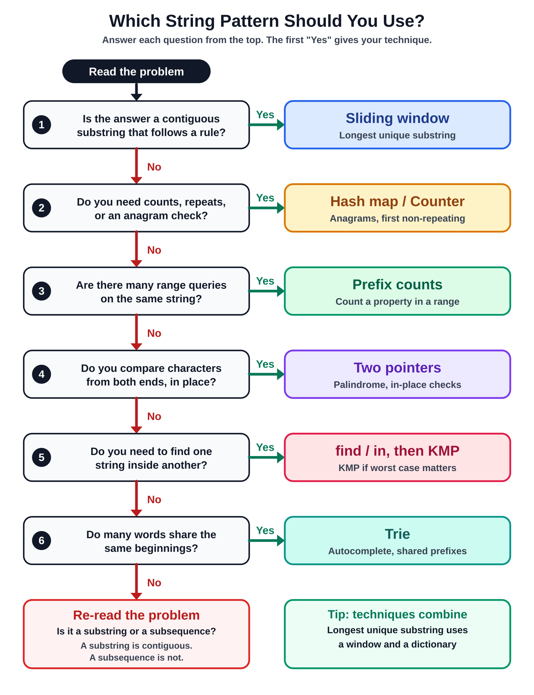

# String Algorithms in Python

Complete, tested code for the EmiTechLogic guide
**[String Algorithms in Python: Essential Patterns and Techniques](https://emitechlogic.com/string-algorithms-in-python/)**.

It is part of the [Data Structures and Algorithms with Python](https://emitechlogic.com/data-structures-and-algorithms-with-python/) series.
This article continues from [Prefix Sum in Python](https://emitechlogic.com/prefix-sum-in-python/).



## What is inside

- Every code example from the article, organized in a small Python package
- 94 tests, including random tests that compare each fast solution with a slow, obvious one
- Runnable example scripts that print the outputs shown in the article
- The five diagrams from the article (SVG)
- A GitHub Actions workflow that runs the tests on Python 3.10, 3.11, 3.12, and 3.13

## Quick start

```bash
git clone https://github.com/Emmimal/string-algorithms-in-python.git
cd string-algorithms-in-python

python -m venv .venv
source .venv/bin/activate          # Windows: .venv\Scripts\activate

python -m pip install -r requirements-dev.txt
python -m pytest -q                # run all tests
python examples/run_all_examples.py
python examples/modern_shortcuts.py
```

The package has no runtime dependencies. It uses only the standard library.

## Python version

Code was written for modern Python. I ran the tests and examples on **Python 3.12**.
The GitHub Actions workflow also checks 3.10, 3.11, and 3.13 once you push the repository.
`itertools.batched` (used only in `examples/modern_shortcuts.py`) needs Python 3.12 or newer,
and that script skips it on older versions.

## Where each article section lives

| Article section | File | Functions |
|---|---|---|
| String Immutability and Its Performance Implications | `string_algorithms/concatenation.py` | `build_slow`, `build_fast`, `edit_with_list` |
| Two Pointers for String Problems, Check Whether a String Is a Palindrome | `string_algorithms/two_pointers.py` | `is_palindrome_simple`, `is_palindrome`, `is_palindrome_short` |
| Hashing and Character Frequency Counting, Anagrams, First Non-Repeating Character | `string_algorithms/frequency.py` | `is_anagram`, `first_non_repeating`, `group_anagrams` |
| Sliding Window for Substrings, Longest Substring Without Repeating Characters | `string_algorithms/sliding_window.py` | `longest_unique_substring` |
| Prefix-Based String Techniques | `string_algorithms/prefix.py` | `build_vowel_prefix`, `vowels_in_range` |
| Find a Pattern Within a String, KMP, Rabin-Karp, `find_all` | `string_algorithms/searching.py` | `naive_search`, `find_all`, `build_lps`, `kmp_search`, `rabin_karp` |
| Reverse a String, Practice Problems | `string_algorithms/problems.py` | `reverse_string`, `reverse_words`, `is_subsequence`, `is_subsequence_short`, `longest_common_prefix` |
| Modern Python Shortcuts for String Problems | `examples/modern_shortcuts.py` | runnable script |

## Quick usage

```python
from string_algorithms import (
    is_anagram, kmp_search, longest_unique_substring, rabin_karp,
)

print(longest_unique_substring('abcabcbb'))   # 3
print(is_anagram('listen', 'silent'))         # True
print(kmp_search('ababcabab', 'abab'))        # [0, 5]
print(rabin_karp('ababcabab', 'abab'))        # [0, 5]
```

## Complexity at a glance

| Problem | Approach | Time | Extra space |
|---|---|---|---|
| Reverse a string | Slicing | O(n) | O(n) |
| Palindrome check | Two pointers | O(n) | O(1) |
| Anagram check | `Counter` | O(n) | O(k) |
| First non-repeating character | Two passes | O(n) | O(k) |
| Longest unique substring | Sliding window | O(n) | O(k) |
| Pattern search | Naive | O(n*m) worst | O(1) |
| Pattern search | KMP | O(n + m) | O(m) |
| Pattern search | Rabin-Karp | O(n + m) average, O(n*m) worst | O(1) |
| Vowel range queries | Prefix counts | O(n) build, O(1) per query | O(n) |

`k` is the number of distinct characters.

## Design notes

- All search functions return **every** match, including overlapping ones, and return `[]` for an empty pattern. This is a deliberate choice, so all four search implementations behave the same way.
- `rabin_karp` always confirms a hash match with `startswith`, so collisions cannot cause a wrong answer.
- Tests use fixed random seeds, so failures are reproducible.

## Diagrams

| Diagram | File |
|---|---|
| Why `+=` is slow and `join()` is fast | `docs/images/why-string-concat-is-slow-vs-join.svg` |
| Sliding window on `abcabcbb` | `docs/images/why-sliding-window-longest-substring.svg` |
| Counter tally for `listen` and `silent` | `docs/images/counter-tally-listen-silent-anagram.svg` |
| KMP LPS table for `abab` | `docs/images/kmp-lps-table-abab.svg` |
| Pattern decision tree | `docs/images/string-pattern-decision-tree.svg` |

## Project layout

```text
string-algorithms-in-python/
|-- string_algorithms/      # the code from the article
|-- tests/                  # pytest tests
|-- examples/               # runnable scripts
|-- docs/images/            # the five SVG diagrams
|-- .github/workflows/      # CI: tests on Python 3.10-3.13
|-- pyproject.toml
|-- requirements-dev.txt
`-- LICENSE
```

## License

MIT. See [LICENSE](LICENSE).
